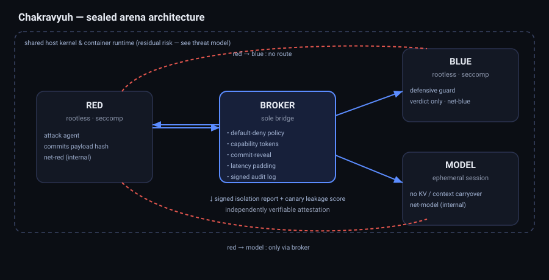

# Chakravyuh

[](https://github.com/bhaskardwivedii/chakravyuh/actions/workflows/tests.yml)
[](https://github.com/bhaskardwivedii/chakravyuh/actions/workflows/arena.yml)
[](https://bhaskardwivedii.github.io/chakravyuh/verify/)

**A sealed multi-tenant arena for trustworthy adversarial AI-safety testing.**
Hack in Hills '26 · Track 04 — *Securing Adversarial AI Safety Testing
Infrastructure (Bayora)*

> A safety finding is only as trustworthy as the isolation behind it.

Bayora runs a red team, a blue team and a client LLM together in one shared
Docker sandbox. That co-location is the problem: if red's payloads leak to blue,
or blue's logic leaks to red, or the model is contaminated between tests, every
"pass" or "fail" it produces is meaningless. Chakravyuh turns that shared
sandbox into **three sealed lanes bridged by one policy-enforcing broker**, and —
the part most submissions skip — it makes the isolation a **number you can
measure** instead of a claim you have to trust.

---

## The one-minute version

- **Three sealed lanes.** Red, blue and the client LLM each run in a rootless,
  seccomp-confined, capability-dropped container on its **own internal network**.
  No lane can route to another.
- **One broker.** The only path between lanes. It enforces a **default-deny**
  policy, issues least-privilege **capability tokens**, runs **commit-reveal** so
  blue never sees red's payloads before a test closes, starts a **fresh model
  session** per test, and **pads response latency** to blunt timing channels.
- **A verifiable record.** Every security event is written to a hash-chained log
  sealed with an **Ed25519-signed Merkle root**. An independent verifier replays
  it; tampering, reordering or deletion is detected.
- **Isolation you can measure.** An insider **canary-probe** suite plants secret
  tokens in each lane and tries to steal them from the others. The score is the
  number recovered. **Target: 0.**

**Measured results (all reproducible — see [`docs/RESULTS.md`](docs/RESULTS.md)):**
- Canary leakage: **4 on the insecure baseline → 0 on the hardened arena.**
- Timing side-channel: padding removes **~80%** of a secret-dependent latency
  signal (attacker accuracy 1.00 → ~0.60).
- Escape primitives (`unshare`, `mount`, raw socket, `ptrace`, RO-rootfs write):
  **all blocked** while real app syscalls still work.
- At-scale evaluation over an adversarial corpus: **0% false positives**, and the
  arena surfaces a real guard gap — obfuscated/evasion attacks slip through while
  jailbreak/injection are caught.
- Access control: per-subject bootstrap keys — the untrusted red tenant **cannot
  mint an operator token** (verified: 401).
- Audit trail verifies end-to-end and a finding is **reconstructed from the
  signed log**; falsifying one field breaks the signature.
- **41 passing tests.**

---

## Quick start

```bash
# Full demo: build, boot, run a red/blue/model test, seal + verify the audit log
bash scripts/demo.sh
# open http://localhost:8000/  for the live isolation dashboard

# The headline benchmark: canary leakage, hardened vs insecure baseline
bash scripts/benchmark.sh

# Unit + integration tests (no Docker needed)
pip install -r docker/requirements.txt pytest
PYTHONPATH=. pytest -q
```

```bash
# More proofs
bash scripts/verify_isolation.sh      # escape primitives blocked in a hardened container
python3 -m probes.timing_channel      # timing-channel defense, measured
```

Requirements: Docker + Docker Compose. Everything runs on `python:3.12-slim`;
no GPU, no model download, no proprietary hardware. By default a deterministic
mock "model" is used so the arena runs anywhere; to test a **real small model**,
run Ollama (`ollama serve` with `llama3.2:1b`) and set `OLLAMA_URL` on the
`model` service in `docker-compose.yml` — the security layer is unchanged.

---

## Verify a finding yourself

Every run ends with a signed report and a hash-chained audit log. You don't have
to trust our scorecard: open the **[browser verifier](https://bhaskardwivedii.github.io/chakravyuh/verify/)**,
drop in `/tmp/chakravyuh_report.json` and `/tmp/chakravyuh_export.json` from your own
run (or the files attached to any [arena CI run](https://github.com/bhaskardwivedii/chakravyuh/actions/workflows/arena.yml)),
and it re-hashes every record, rebuilds the Merkle root, checks both Ed25519
signatures and reconstructs the finding — entirely client-side, nothing uploaded.
The built-in samples include a tampered log; the page names the exact record that
was changed.

```bash
# same checks from the command line, and the verifier's own tests
node tests/verifier/check_files.js /tmp/chakravyuh_export.json /tmp/chakravyuh_report.json
node --test tests/verifier/verify.test.js   # byte-for-byte parity with common/audit.py
```

The page also works offline: open `docs/verify/index.html` directly.

## Architecture

Five layers — **isolate, segment, broker, record, observe**. Red has no network
route to blue or model; every cross-lane hop goes through the broker and is
audited.



| Layer | What it does | Code |
|-------|--------------|------|
| **Isolate** | rootless containers, seccomp allowlist, `cap_drop ALL`, read-only FS, cgroup limits | `docker-compose.yml`, `docker/seccomp/` |
| **Segment** | one internal network per lane; broker is the only bridge | `docker-compose.yml` |
| **Broker** | policy, tokens, commit-reveal, latency padding | `broker/` |
| **Record** | hash-chained, Ed25519-sealed audit log + independent verifier | `common/audit.py` |
| **Observe** | metadata-only dashboard, canary leak score | `dashboard/`, `probes/` |

Full requirement-by-requirement mapping to the 6 objectives and 7 verticals:
[`docs/OBJECTIVES.md`](docs/OBJECTIVES.md). Trust boundaries and residual risk:
[`docs/THREAT_MODEL.md`](docs/THREAT_MODEL.md).

---

## What's novel here

1. **Isolation as a tested property, not an assumption.** The canary suite and
   the timing experiment give *falsifiable numbers* — leak count and attacker
   accuracy. Most isolation work asserts boundaries; we probe them from the
   inside and report what got through.
2. **Commit-reveal for the red/blue protocol.** Red binds its corpus with a hash
   before the test and reveals it only after close — blue can't peek, red can't
   swap. This is a protocol-level fix, not just a network rule.
3. **An audit layer that doesn't leak.** Observability is metadata-only by
   construction: the log stores payload *hashes*, never payload text (verified).
4. **A signed isolation report + replayable findings.** Every run emits a
   verifiable attestation (block rate, leak score, audit root, residual risk),
   and any finding can be *reconstructed from the signed log alone* — the exact
   "independently reconstructed" bar objective 03 sets.
5. **Evaluated at scale, not on toy prompts.** A corpus-based harness reports
   attack-success / block / false-positive rates and surfaces where the defence
   actually fails (obfuscated attacks) — which is the point of a red/blue loop.
6. **Honest, measured guarantees.** A written residual-risk model paired with
   reproducible scores — directly answering objective 06, which most teams
   treat as an afterthought.

---

## How the datasets drop in

The sample red payloads mirror the structure of the brief's suggested datasets.
To run the real corpora, point `PAYLOAD_FILE` (in the `red` service) at a
newline-delimited export of **JailbreakBench**, **AdvBench** or **HarmBench**
prompts; **ToxiGen**/**HH-RLHF** give a benign baseline for false-positive rates;
**NVD/CVE** container-escape entries inform the threat model. No code change
needed.

---

## Repository layout

```
broker/        FastAPI broker: policy engine, bootstrap-gated tokens, commit-reveal,
               latency padding, audit + canary + signed-report endpoints, dashboard
common/        audit log (hash chain + Merkle + Ed25519 + verifier), commit-reveal,
               signed isolation report, audit replay (reconstruct a finding)
lanes/         model (ephemeral sessions), blue (guard/scorer), red (attack tenant),
               operator (trusted control plane — opens/closes/seals)
probes/        canary insider-probe suite, timing-channel experiment, at-scale
               evaluation harness + labelled corpus
dashboard/     single-file metadata-only isolation dashboard
docker/        Dockerfile, requirements, entrypoint, seccomp profile (+ empirical set)
scripts/       demo.sh (demo + signed scorecard + replay), benchmark.sh (leakage),
               verify_isolation.sh (escape primitives blocked)
tests/         41 pytest cases: audit, commit-reveal, policy, tokens, padding,
               timing channel, signed report, token gating, evaluation, replay, e2e
docs/          OBJECTIVES.md, THREAT_MODEL.md, RESULTS.md, architecture.svg
docs/verify/   browser verifier (GitHub Pages): verify.js, samples from a real run
tests/verifier/  verifier parity tests against the Python implementation
.github/       CI: tests.yml (pytest + verifier), arena.yml (full Docker run)
docker-compose.yml           hardened arena
docker-compose.insecure.yml  insecure baseline (for the benchmark)
```

## Team

**Team Chakravyuh** — Hack in Hills '26, Track 04 (Bayora). Two workstreams:
container isolation, networking and audit backend; dashboard, UX and
threat-model research.

## Security note

`BROKER_SECRET` defaults to a development value — set a strong secret via the
environment before any real deployment. This is a hackathon proof of concept;
see the residual-risk section before trusting it with real safety evaluations.
